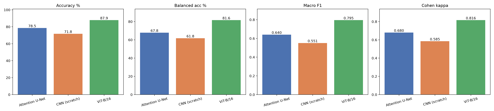
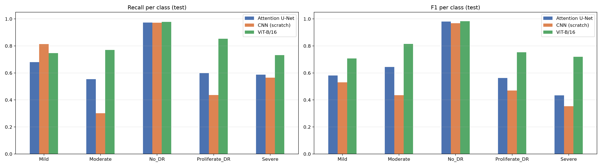

# Diabetic Retinopathy Detection

Automated classification of diabetic retinopathy (DR) severity from retinal
fundus images, using an Attention U-Net with a ResNet50 encoder, compared
against a CNN trained from scratch and a Vision Transformer (ViT-B/16).

Diabetic retinopathy is one of the leading causes of preventable blindness.
Early detection substantially reduces vision loss, but manual screening of
fundus images is slow, expensive, and limited by the availability of trained
specialists. This project trains a classifier to grade DR severity into five
classes: **No_DR**, **Mild**, **Moderate**, **Severe** and **Proliferate_DR**.

Dataset: [Roboflow Universe - diabetic-retenopathy](https://universe.roboflow.com/drproject/diabetic-retenopathy)

## Approach

The encoder is a pretrained ResNet50. The decoder is the standard U-Net path
with **additive attention gates** on every skip connection, so background
regions are suppressed before the skip is merged. The final feature map passes
through a **CBAM** block, global average pooling and a dense classifier

The dataset is heavily imbalanced, so two things are done about it:

- **Focal loss** with per-class weights, which down-weights the easy majority
  samples and concentrates gradient on the rare severity grades.
- **Class-specific augmentation** via Albumentations: classes whose sample
  count falls below 70% of the per-class average get a much more aggressive
  augmentation pipeline than the rest.

Images are resized to 224x224 and normalised. Because plain accuracy is
dominated by the No_DR class, runs are compared on **balanced accuracy** and
**Cohen's kappa** rather than accuracy alone.


## Results

Three variants were trained under a constrained compute budget. The
class-specific augmentation run performs best:

| Run | Config | Loss | Augmentation | Test accuracy | Balanced accuracy | Cohen's kappa |
|---|---|---|---|---|---|---|
| **Class-specific aug** | `configs/class_specific_aug.yaml` | Focal | Albumentations, per class | **78.54%** | **67.85%** | **0.6797** |
| Baseline | `configs/baseline.yaml` | Focal | Keras, light uniform | see notebook | see notebook | see notebook |
| Increased aug | `configs/increased_aug.yaml` | Cross-entropy | Keras, strong uniform | see notebook | see notebook | see notebook |

The best run was trained with batch size 16 for up to 30 epochs, with early
stopping firing at epoch 28. The gap between accuracy (78.54%) and balanced
accuracy (67.85%) shows the minority grades are still the hard part — that gap
is the number to push on next.

Per-run numbers, confusion matrices and ROC curves are written to the run's
results directory; the original notebook outputs are preserved in
`notebooks/`.

## Model comparison: Attention U-Net vs CNN vs ViT

The Attention U-Net (class-specific aug run above) was compared with two other
model families on the **identical stratified test set** (2,544 images, seed 42,
per-class counts 241 / 661 / 1300 / 204 / 138):

- **CNN from scratch**: 10 conv layers (5 stages of 2x Conv3x3-BN-ReLU + MaxPool,
  32 to 512 channels) with a GAP + MLP head, random init, 4.8M params.
- **ViT-B/16**: Vision Transformer pretrained on ImageNet-1k, fine-tuned end to
  end with a new 5-class head, 85.8M params.

Both use the same class-weighted focal loss (alpha 0.25, gamma 2), early stopping
on validation loss and ReduceLROnPlateau as the U-Net. They were trained in
PyTorch 2.11 (CUDA 12.8, FP16) on an RTX 5070 Ti Laptop GPU with GPU-side
augmentation (rotation, shift, zoom, flips, brightness/contrast).

| Model | Accuracy | Balanced accuracy | Macro-F1 | Cohen's kappa | Params | Epochs / train time |
|---|---|---|---|---|---|---|
| Attention U-Net (ResNet50) | 78.54% | 67.85% | 0.640 | 0.680 | 74.8M | 28 / 114 min |
| CNN from scratch | 71.78% | 61.76% | 0.551 | 0.585 | 4.8M | 40 / 58 min |
| **ViT-B/16** | **87.85%** | **81.59%** | **0.795** | **0.816** | 85.8M | 15 / 17 min |




- **ViT-B/16 is best by a clear margin.** Global self-attention combines lesions
  spread across the whole retina, and the gains are largest on the minority
  grades (recall: Moderate 0.77 vs 0.55 for the U-Net, Proliferate_DR 0.85 vs
  0.60, Severe 0.73 vs 0.59).
- **CNN vs ViT is statistically significant**: McNemar test, 503 images correct
  only for ViT vs 94 only for the CNN (p < 0.001); bootstrap 95% CIs of balanced
  accuracy are 0.59-0.64 (CNN) and 0.79-0.84 (ViT).
- **Pretraining matters**: the from-scratch CNN learns No_DR well but only gets
  30% of Moderate images right.
- **Moderate** is the hardest grade for all three models; No_DR is easy for all
  (recall about 0.97).

Note: the U-Net numbers come from its original TensorFlow run; the CNN and ViT
use the same data split but a different framework, machine and augmentation
pipeline.

Notebooks (in `notebooks/model_comparison/`, outputs included):

| Notebook | What it does |
|---|---|
| `00_setup_envs_and_data.ipynb` | Creates the `dr-torch` environment (PyTorch CUDA 12.8), unzips the Roboflow export and recreates the 75/10/15 split at 224x224 |
| `02_cnn_from_scratch.ipynb` | Trains and evaluates the CNN |
| `03_vit_b16.ipynb` | Fine-tunes and evaluates ViT-B/16 |
| `04_model_comparison.ipynb` | Loads all three results and produces the tables, charts, McNemar test and bootstrap CIs |
| `common.py` | Shared PyTorch pipeline: in-RAM data loading, GPU augmentation, focal loss, training loop, metrics |

The Attention U-Net counterpart is `notebooks/02_train_class_specific_aug.ipynb`.
The notebooks use absolute Windows paths (`DATASET_PATH`, `OUT_DIR` in the first
code cell); edit them for your machine. Results and figures are in
`reports/model_comparison/`.

## Repository layout

```
configs/            One YAML per experiment - the full description of a run
notebooks/          Original experiment notebooks, with their outputs intact
  model_comparison/   CNN and ViT notebooks, shared common.py, comparison notebook
reports/figures/    Dataset EDA and quality figures
reports/model_comparison/  Comparison results (JSON/CSV) and figures
scripts/            Command-line entry points
src/dr/             The library
  config.py           Config dataclasses loaded from configs/*.yaml
  data/               Dataset prep, inspection, augmentation, generators
  models/             Attention gates, CBAM, the Attention U-Net
  training/           Losses, metrics, callbacks, the training loop
  evaluation/         Metrics, figures, run reports
tests/              Unit and smoke tests
```

## Setup

```bash
python -m venv .venv && source .venv/bin/activate
pip install -e .
```

The version bounds in `requirements.txt` are load-bearing: the pipeline uses
Keras 2 APIs (`ImageDataGenerator`, `tf.keras.utils.Sequence`) that Keras 3
removed, so TensorFlow is pinned below 2.16, which in turn pins numpy below 2.
Albumentations is pinned below 2.0 because 2.x renamed most transform
arguments.

## Usage

### 1. Prepare the dataset

Download the Roboflow export, then re-split and resize it. This pools every
image, re-splits with stratification (75/10/15 by default), resizes to
224x224, and verifies the result:

```bash
python scripts/preprocess.py \
    --source data/raw/diabetic-retenopathy-v8i \
    --output data/processed
```

The output is the layout everything else expects:

```
data/processed/{train,validation,test}/{Mild,Moderate,No_DR,Proliferate_DR,Severe}/*.jpg
```

### 2. Train

```bash
python scripts/train.py --config configs/class_specific_aug.yaml \
    --dataset data/processed
```

This trains, evaluates on validation and test, writes the figures, and saves
`report.txt` plus `results.json` under the config's results directory.

Any config value can be overridden from the command line for a quick run:

```bash
python scripts/train.py --config configs/baseline.yaml \
    --dataset data/processed --epochs 2 --batch-size 4
```

The dataset path can also come from the environment, which keeps machine-specific
paths out of the configs:

```bash
export DR_DATASET_PATH=/path/to/data/processed
```

### 3. Evaluate a saved checkpoint

```bash
python scripts/evaluate.py --config configs/class_specific_aug.yaml \
    --dataset data/processed --split test
```

### Using the library directly

```python
from dr.config import ExperimentConfig
from dr.evaluation import evaluate
from dr.training import train

config = ExperimentConfig.from_yaml("configs/class_specific_aug.yaml")
model, history, generators, class_weights = train(config)
result = evaluate(model, generators.test, config.data.class_names, "Test")
print(result.metrics)
```

## Configuration

An experiment is fully described by its YAML file — no paths or
hyper-parameters are hard-coded. The sections map onto the dataclasses in
`src/dr/config.py`:

| Section | Controls |
|---|---|
| `paths` | Dataset location, where checkpoints and results are written |
| `data` | Image size, batch size, augmentation backend and strength |
| `model` | Encoder, dropout, classifier head width |
| `training` | Epochs, learning rate, loss, class weighting, callbacks |

Setting `data.augmentation_backend` to `albumentations` enables the
class-specific pipelines; `keras` applies one uniform pipeline to every class.

## Tests

```bash
pytest
```

The suite covers config loading, dataset preparation and inspection, the
augmentation pipelines, the generators, and a build-compile-fit smoke test of
the model. Tests that need a heavy dependency skip themselves when it is not
installed, so a partial environment still runs what it can.

## Notebooks

The notebooks are kept as the record of the original experiments, complete
with their outputs. The library in `src/dr/` is the maintained implementation
of the same pipeline; new work should go there.

| Notebook | Corresponding config |
|---|---|
| `01_preprocessing.ipynb` | `scripts/preprocess.py` |
| `02_train_class_specific_aug.ipynb` | `configs/class_specific_aug.yaml` |
| `03_train_baseline_aug.ipynb` | `configs/baseline.yaml` |
| `04_train_increased_aug.ipynb` | `configs/increased_aug.yaml` |

## Future work

- Close the accuracy / balanced-accuracy gap on the minority grades
- Ensemble the ViT and the Attention U-Net
- Explainability (attention map and Grad-CAM overlays) for clinical review
- Real-time deployment for telemedicine screening
